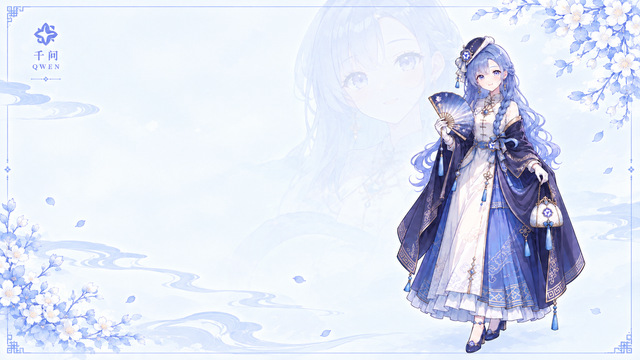

# dsh-skin-QWEN · QWEN Blossom (千问花语)

[中文 README](README.md) | **English**

A dual-theme classical-Chinese-style skin for the DeepSeek Harness (DSH) Web GUI. This is a presentation-only client plugin: `apply()` only touches a body-scoped attribute, a background canvas layer and a state projection — it injects no services, emits no Cordis events and never touches model requests. Disposal restores every mutated value exactly.

- **Light mode** — *Dreamy Blue QWEN Blossom Portrait*: pale-blue xuan paper, blossom branches and a Hanfu figure.
- **Dark mode** — *Moonlit Pavilion Dreamscape*: a moonlit pavilion in indigo night with gilt lanterns.
- Theme switching **follows the native DSH dark-theme attribute** `body[data-ds-dark-theme]`; the two painting layers cross-fade in pure CSS (200 ms). No JS theme listener, no custom toggle.

| Light | Dark |
| --- | --- |
|  |  |

## Features

- **Dual-theme token system** — one `--qwen-*` design-token set per theme (xuan-paper blue for light, indigo-night gilt for dark), plus a full override of the host `--dsw-*` tokens (with `!important` to beat inline suppression). Body-text colors are chosen for ≥ 4.5:1 contrast (light `#23306b`, dark `#eef2ff`).
- **Classical borders** — meander (回纹) corner ornaments (inline SVG: indigo outer line + gilt inner line + center lozenge) on the composer card, terminal cards and modal dialogs; a gilt-indigo double-line frame (`border` + `inset box-shadow`) unifies panels and overlays.
- **Panel backing** — semi-transparent xuan-paper (light) / night-veil (dark) backing on the sidebar, conversation top bar, details bar and goal/todo/queue dock cards keeps buttons and text crisp; the conversation area stays fully transparent so the painting shows through.
- **Active-chat dimming** — when an active conversation is detected (`[data-phase='active'] [data-chat-flow]`, projected to `body[data-qwen-chat-active]`), the background painting dims to 55% opacity for quieter reading.
- **Input-performance red line** — the mutation-projection observer filters `[data-input-backdrop]` ghost-text nodes (rebuilt on every keystroke in rc8), so typing stays fast.
- **Stacking contract** — the skin never raises overlay z-index (host contract: menu 100 / modal 1000 / portal 1100); the sidebar stacking context is released while the settings dialog is open; background transitions are disabled under `prefers-reduced-motion`.

## Installation

Requirements: DSH `0.1.5-rc.1` (see `skin.json → dshCompatibility`), target profile `web`. The built bundles in `lib/` are committed, so **no build step is needed** to install.

1. Clone this repository to a local directory:

   ```sh
   git clone https://github.com/azumaki-art/dsh-skin-QWEN.git
   ```

2. Install with an **absolute path** (a bare directory name is treated as an npm package name and 404s):

   ```sh
   dsh plugin --profile web add <ABSOLUTE_PATH_TO>/dsh-skin-QWEN
   # Windows example:
   dsh plugin --profile web add C:/Users/you/dsh-skin-QWEN
   ```

3. If another skin is currently enabled, make the skins mutually exclusive first — only one skin should be active at a time. Either disable the other skin(s) in the `dsh-skin managed` block of `~/.dsh/cordis.patch.yml` (set `disabled: true`, and `disabled: false` for `ui-skin-qwen-blossom`), or use the [dsh-deep-whale](https://github.com/Small-tailqwq/dsh-deep-whale) skin-manager UI if you have it installed.

4. Restart the DSH server and refresh the page. The skin loads on start and restores the original look exactly on unload/removal (observers disconnected, CSS variables and body attribute restored to their retained originals, backdrop layers removed — hot switching leaves no residue).

Manifest facts: id `qwen-blossom`, package `@dsh-external/dsh-client-ui-skin-qwen-blossom`, body attribute `data-dsh-qwen-blossom`, wiring id `ui-skin-qwen-blossom`, order 30.

## Development

Node.js 20+ recommended. From the package root:

```sh
npm install         # dev dependencies (vitest, tsdown, lightningcss, jsdom)
npm run embed-art   # only after changing assets/*.webp: webp → base64 → src/client/art.ts
npm run build       # tsdown → lib/ + refresh skin.build.json fingerprint
npm test            # vitest (jsdom): apply/dispose lifecycle + stylesheet contract/red lines
```

> Note: the fingerprint step of `npm run build` calls `../dsh-deep-whale/scripts/write-skin-build.mjs`, i.e. it expects a sibling clone of [Small-tailqwq/dsh-deep-whale](https://github.com/Small-tailqwq/dsh-deep-whale) next to this package. Without it, run `npx tsdown` to regenerate `lib/` only (then `skin.build.json` keeps its previous fingerprint — refresh it via the sibling repo's script before publishing a change).

Layout:

- `src/client/index.ts` — browser half (backdrop mounting, state projection, MutationObserver).
- `src/client/qwen-blossom.module.css` — all skin styles (11 sections; element/attribute selectors only, no `:global` needed).
- `src/client/art.ts` — generated base64 WebP art constants (do not edit by hand; regenerate with `npm run embed-art`).
- `src/index.ts` — node half (empty apply).
- `tests/apply.spec.ts` — mount/restore of body attribute, backdrop and CSS variables; idempotent activation cycles; active-chat projection; ghost-text filtering; observer disconnect.
- `tests/css-contract.spec.ts` — light/dark token-block contracts, pure-CSS cross-fade, host-token `!important` overrides, and repository red lines (no `#root`, all z-index < 1000, no body-level `:has`, no 2^31 magic numbers, no remote runtime assets).
- `lib/` — committed distribution bundles (`client.js`, `index.js`; source maps are not committed).

The package skeleton and build pipeline follow the orca-link reference architecture of [Small-tailqwq/dsh-deep-whale](https://github.com/Small-tailqwq/dsh-deep-whale) (local reference clone only; no skin code or assets were copied from it).

## Assets & Licensing

Code is licensed under **MIT** (Copyright (c) 2026 shxvx). The two background paintings (*Dreamy Blue QWEN Blossom Portrait*, *Moonlit Pavilion Dreamscape*) are AI-generated images provided by the user and are **excluded from the MIT license**: copyright remains with the respective rights holders, and the copies embedded in `src/client/art.ts`, `lib/client.js`, `assets/` and `preview/` carry the same terms. No commercial use of the artwork is licensed. See [LICENSE](LICENSE) and [NOTICE](NOTICE) for the full provenance chain.
